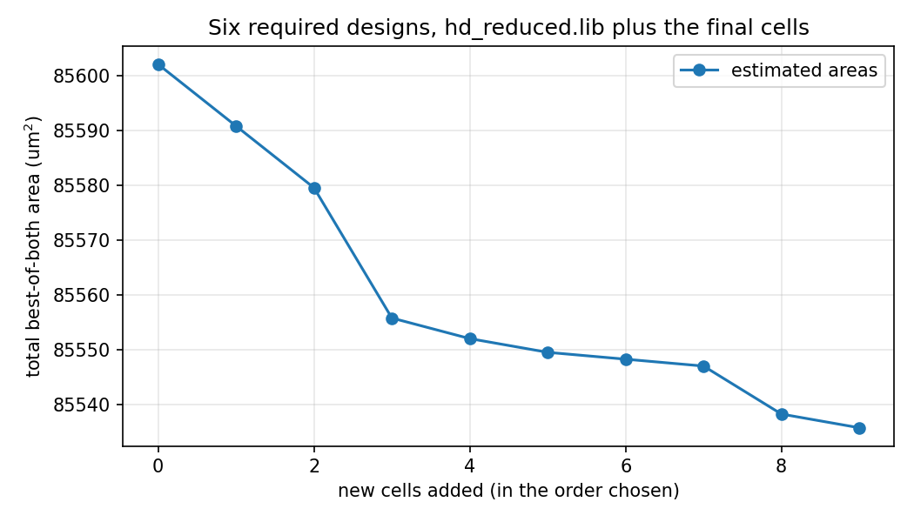

# DD2 Project 1, Option 2: Finding Cells Worth Adding

**CSCE 3304 Digital Design II, Fall 2026 · Group 5**

Salma Elmarakby (900232658) · Mikhael Khalil (900232633) · Marina Mikhael (900233146)

Option 2 (three students) · AI used as a development aid (overview, section 4.1)

Commit of tag `final`: see `git rev-list -n 1 final` (the report is built before the tag is placed)

## 1. Introduction

HD (`sky130_fd_sc_hd`) already has most small single-stage CMOS functions. The question of Option 2 is which small functions that real designs compute again and again HD is missing, and whether adding cells for them reduces the area Yosys and ABC reach. We built a tool, in Python 3 with Yosys 0.70+201 and its ABC, that runs the twelve steps of handout section 4 from one command (`make all`):

1. synthesizes the six required designs to AIGs, before and after ABC restructuring;
2. enumerates every cut of up to 4 inputs with our own code and checks every cut by simulation;
3. classifies the cut functions up to input order (P), input order and output inversion (P+Nout) and NPN;
4. costs every class in CMOS stages, inverters and transistors with at most 3 in series;
5. checks every class against HD (Table 3 of the handout) and drops what HD has;
6. estimates the area of the rest with a model fitted to HD's x1 cells;
7. ranks the candidates by estimated saving;
8. writes a cell request (Appendix A) for each and an extended Liberty file;
9. maps every design with and without the new cells, with both scripts, and checks every mapping;
10. selects the final set greedily by remapping;
11. reads real cells back from cell responses;
12. tests the sensitivity to the area estimate (the 30% experiment).

The result, measured on the six required designs: the final set of 9 cells reduces the total best-of-both area by **0.08%** (85,602.1 to 85,535.8 um2) with estimated areas. It is a small, measured saving, and section 6 explains why it is small and how much of it is noise.

## 2. Method

**Step 1, AIGs.** `read_verilog; synth -flatten -top <top>; async2sync; dffunmap; aigmap; write_aiger`, then ABC `strash; dch; strash` for the restructured graph (`src/extract_aigs.py`). Flip-flop counts match Table 2 of the handout exactly; AND counts are lower than Table 2's (Yosys 0.70 against 0.33), e.g. cpu8 932 against 1,265 (`results/aig_stats.md`).

**Step 2, cuts.** Bottom-up K-feasible cut enumeration with K = 4, no cut limit per node, dominated cuts removed; each cut's 16-bit truth table is computed by composing the fanin tables (`src/cut_enumerator.py`). Every cut is re-simulated on all 2k input combinations by an independent evaluator of the cone (`verify_cut`).

**Step 3, classes.** Canonical representatives under the 24 input permutations (P), additionally the output complement (P+Nout), and additionally the 16 input complements (NPN) (`src/classification.py`).

**Step 4, CMOS cost.** `src/cmos_cost.py` searches four constructions and keeps the cheapest: one complex gate `!T(literals)` over series-parallel networks of up to 8 literals with at most 3 transistors in series in both networks (inverted inputs cost an inverter and a stage); the same plus an output inverter; two complex gates into a NAND2/NOR2; and a two-level AOI + NAND construction from a minimum sum of products, which always exists. The cost is (transistors, stages, inverters).

**Step 5, redundancy.** `src/redundancy.py` compares every class with every single-output combinational cell of HD, by its Liberty `function`: Exists (equal up to input order), Exists with an inverter (output or one input inverted), Contained (an HD cell with its inputs tied to the candidate's inputs or to 0/1), New. The checker uses `hd_usable.lib`; `results/full_hd_check.md` shows that the full HD Liberty gives the same class for all 3,904 four-input P-classes.

**Step 6, area model.** A least-squares fit of the width in sites (0.46 um x 2.72 um) of every x1 HD cell of 1 to 4 inputs against its cost: **sites = 1.985 + 0.451·T + 0.308·(stages − 1)**, rounded up to a whole site for a new cell (`results/area_model.md`).

**Step 7, ranking.** The estimated saving of a class sums, over its occurrences in the restructured AIGs (one per class and root node), the area its cone costs today (the cone's AND count times the design's baseline combinational area per AND) minus the new cell's area (`src/candidates.py`). Exists classes are dropped; Exists-with-an-inverter and Contained classes are kept only if estimated smaller than the HD cell (plus an inverter).

**Step 8, Liberty and requests.** `src/liberty_writer.py` writes the new cell groups inside the library group of `hd_reduced.lib`: area from the model, pins A–D with capacitance 0.0024 pF, output Y with the function (checked to evaluate to the class's truth table before it is written), and one timing arc per input with its unateness computed from the truth table and logical-effort placeholder delays. Yosys must report "Imported 189 + N cell types". One request per cell is written to `cells/requests/` in the format of Appendix A.

**Step 9, mapping and checking.** Every design is mapped with exactly the commands of handout section 2 (scripts A and B), on the baseline and on the extended library (`src/table5.py`). Each netlist is compared with the design before ABC (same `synth` and `dfflibmap`, written in a separate run): both are converted to AIGs, with one-bit flip-flop models generated from the Liberty `ff` groups, and checked with ABC `dsec`, which pairs only primary inputs and outputs; designs without flip-flops (the multiplier) are checked with `cec` (`src/equivalence.py`). Yosys 0.70 sometimes writes a cell pin under an internal signal name after `abc -liberty`; `src/netlist_repair.py` restores the pin, and the repaired netlist must still pass the check.

**Step 10, greedy selection.** The 30 best-ranked candidates with a positive estimated saving are tried in rank order. Each is added to the cells already chosen, all six designs are remapped with both scripts, and the candidate is kept only if the total best-of-both area drops; at most 10 cells (`src/final_flow.py`). The trial mappings skip the equivalence check; the final set is remapped with it, and its total must equal the greedy total (it does, ABC is deterministic).

**Step 11, real cells.** `src/responses.py` reads each response in `cells/responses/`. A response is used only if its status is `pass`, its Liberty file holds exactly one cell group with the requested name and pins, its function (parsed with the full Liberty operator set) equals the requested truth table, and every input has a capacitance. Accepted cells replace the estimated entries, and Table 5, the curve and the 30% experiment are rerun with them.

**Step 12, 30%.** The new cell with the most instances in the final mappings is made 30% smaller in the Liberty, and every design is remapped.

**Delay.** OpenSTA 2.5.0 reports the worst max-delay path of every mapped netlist with the same constraints for all (10 ns clock on the flip-flop clock port, inputs at 0, outputs required at the edge, default slews and loads; `src/sta.py`). The asynchronous path group (reset recovery checks) is excluded.

## 3. Verification

Every check of the flow has a deliberately broken case in `tests/broken/` that must fail (overview, section 4.3, rule 3). `make test` runs all of them.

| Check | What it verifies | Broken case that must fail |
|---|---|---|
| Cut truth tables (`verify_cut`) | Every enumerated cut equals its cone on all 2k inputs | A cut with one truth-table bit flipped (`test_broken_cut_tt.py`) |
| Redundancy checker | All 264 single-output combinational HD cells come out Exists; all 9 counts of Table 4 reproduced | `nand4_1` (0x7FFF) claimed New (`test_broken_redundancy.py`) |
| Liberty loads in Yosys | `read_liberty` succeeds and imports 189 + N cells | A malformed Liberty file (`test_broken_liberty.py`) |
| New-cell functions | Each written cell's function equals its class | A cell whose function is a22oi instead of maj4n (`test_broken_cp2.py`) |
| Mapping equivalence (dsec) | Every mapped netlist equals the design before ABC | cpu8 with one nand2 swapped for nor2 (`test_broken_cp2.py`) |
| Combinational equivalence (cec) | The same for designs without flip-flops | The multiplier with one cell swapped (`test_broken_final.py`) |
| ABC cec itself | ABC finds non-equivalence | Two inequivalent netlists (`test_broken_cec.py`) |
| Gate-level testbenches | SPM and the multiplier compute correct products on the PDK cell models | SPM with one cell swapped must print `ERROR:` (`test_broken_final.py`) |
| Cell responses | Only correct, passing cells are used | Status fail; function ≠ truth table; two cell groups (`test_broken_final.py`) |
| Greedy selection | Only cells that lower the total are kept | A candidate that raises the total (`test_broken_final.py`) |

Further positive checks: the new-cell Verilog models are simulated on all 16 inputs against their truth tables; our Liberty function parser agrees with the CP1 evaluator on every reduced-HD function; Table 1 is reproduced within 0.15% between the usable and reduced libraries.

## 4. Results

### 4.1 AIGs, cuts and classes (`results/aig_stats.md`, `results/cut_stats.md`)

| Design | AND (orig) | AND (after ABC) | Cuts (orig) | Cuts (after) | 4-input P-classes (orig / after) |
|---|---|---|---|---|---|
| cpu8 | 932 | 849 | 7,021 | 6,052 | 179 / 160 |
| dsp8 | 1,661 | 1,293 | 13,261 | 10,733 | 214 / 187 |
| arlet6502 | 2,464 | 2,091 | 20,184 | 16,725 | 243 / 221 |
| uart_apb | 3,550 | 1,770 | 18,734 | 11,133 | 157 / 102 |
| risc8 | 5,485 | 4,876 | 42,979 | 37,010 | 217 / 190 |
| fir10 | 8,173 | 6,390 | 83,886 | 67,408 | 220 / 209 |
| **Union** | **22,265** | **17,269** | **186,065** | **149,061** | **434 / 393** |

All 335,126 cuts pass the simulation check. Across the six designs, the 4-input cuts that depend on all their inputs fall into 434 P-classes, 293 P+Nout classes and 69 NPN classes before ABC, and 393 / 270 / 67 after.

### 4.2 Table 1 reproduced (`results/table1.md`)

Yosys 0.70+201, area in um2. The reduced library costs at most 0.15% against the usable library (handout: at most 0.5%).

| Design | A, usable | A, reduced | B, usable | B, reduced |
|---|---|---|---|---|
| cpu8 | 4,206.5 | 4,206.5 | 4,265.3 | 4,259.1 |
| dsp8 | 5,843.1 | 5,846.9 | 6,040.8 | 6,040.8 |
| arlet6502 | 9,303.9 | 9,310.2 | 9,559.2 | 9,572.9 |
| uart_apb | 12,655.9 | 12,655.9 | 13,057.5 | 13,057.5 |
| risc8 | 28,168.3 | 28,170.8 | 28,122.0 | 28,133.2 |
| fir10 | 25,449.4 | 25,449.4 | 29,015.3 | 29,015.3 |

The numbers differ from the handout's (Yosys 0.33) by up to 4% because ABC changed between versions; the comparison that matters, usable against reduced on one version, holds.

### 4.3 HD classes, redundancy and the Table 4 self-test

HD's 83 single-output combinational families give 24 four-input P-classes, 12 P+Nout classes and 4 NPN classes (`results/hd_classes.md`). The checker reproduces every count of Table 4: 24 Exists, 20 Exists with an inverter, 38 Contained, 3,822 New, 9 New one-stage, 5 of those with ≤ 3 in series and ≤ 12 transistors, and 8 read-once one-stage cells of which 6 Exist and 2 are Contained (`results/table4_self_test.md`).

On the 393 four-input classes of the restructured AIGs (`results/candidates.md`): 18 Exist (all dropped, e.g. `0x007F` = a31oi), 20 Exist with an inverter (e.g. `0x000B`, a211oi plus one inverter), 23 are Contained (e.g. `0x001F` in a221oi with one input tied), 332 are New. The 43 inverter/contained classes are all kept as candidates because the model estimates them smaller than the HD cell plus an inverter, or than the containing cell; 375 candidates remain, 244 with a positive estimated saving.

### 4.4 Area model (`results/area_model.md`)

Fitted on 61 x1 HD cells: mean absolute error 0.77 sites (12.9%), 0.56 sites (13.6%) on the 13 single-stage cells and 0.83 sites (12.7%) on the 48 multi-stage cells; the largest errors (up to 3.9 sites) are cells HD builds with wider transistors or different topologies than our ≤ 3-series construction (e.g. nand4, nor4).

### 4.5 Greedy selection and Table 5 (`results/greedy.md`, `results/table5_final_est.md`)

Of the 30 candidates tried, 9 lowered the total: `0x000B`, `0x0EE0`, `0x00EB`, `0x009F`, `0xEEE8`, `0x008E`, `0x00BE`, `0xA888`, `0x006F`. Table 5 with the final set, estimated areas, every mapping passing dsec:

| Design | Script | Baseline (um2) | With new cells (um2) | Reduction | New-cell instances | Equivalence |
|---|---|---|---|---|---|---|
| cpu8 | A | 4,206.5 | 4,205.3 | +0.03% | 0 | pass |
| cpu8 | B | 4,259.1 | 4,244.1 | +0.35% | 0 | pass |
| dsp8 | A | 5,846.9 | 5,846.9 | +0.00% | 1 | pass |
| dsp8 | B | 6,040.8 | 6,065.8 | −0.41% | 6 | pass |
| arlet6502 | A | 9,310.2 | 9,301.4 | +0.09% | 1 | pass |
| arlet6502 | B | 9,572.9 | 9,549.2 | +0.25% | 18 | pass |
| uart_apb | A | 12,655.9 | 12,648.4 | +0.06% | 2 | pass |
| uart_apb | B | 13,057.5 | 13,063.8 | −0.05% | 1 | pass |
| risc8 | A | 28,170.8 | 28,153.3 | +0.06% | 2 | pass |
| risc8 | B | 28,133.2 | 28,313.4 | −0.64% | 33 | pass |
| fir10 | A | 25,449.4 | 25,380.6 | +0.27% | 24 | pass |
| fir10 | B | 29,015.3 | 28,543.6 | +1.63% | 171 | pass |

**Best of both:** cpu8 +0.03%, dsp8 +0.00%, arlet6502 +0.09%, uart_apb +0.06%, risc8 −0.07%, fir10 +0.27%; **total over the required designs +0.08% (85,602.1 → 85,535.8 um2).**

**Real cells.** No cell response has been received (`results/real_cells.md`), so Table 5 with real cells, the real-area curve and the real-area 30% experiment are not measured. The flow produces them unchanged (`python src/run_step.py 11`, then `curve`, `12`, `delay`) once responses are placed in `cells/responses/`.

### 4.6 Cell-by-cell curve (`results/curve.md`)

Total best-of-both area after each cell, in the order chosen: 85,602.1 → 85,590.8 → 85,579.6 → 85,555.8 → 85,552.1 → 85,549.6 → 85,548.3 → 85,547.1 → 85,538.3 → 85,535.8 um2.

### 4.7 The 30% experiment (`results/sensitivity_30pct.md`)

`dd2_g5__f000b_1` (most instances, 193) at 6.1309 um2 instead of 8.7584 um2: the best-of-both total falls to 85,004.0 um2, a reduction of **0.70%** instead of 0.08%, with large shifts per design (dsp8 A −2.78%, risc8 B −1.63%, fir10 B −1.52%) and the cell's instances rising from 29 to 375 in risc8 B and from 0 to 78 in dsp8 A. Every mapping passes dsec.

### 4.8 Delay (`results/delay.md`)

Worst path of the best-of-both mapping of each design (10 ns clock, OpenSTA 2.5.0):

| Design | Baseline: script, area (um2), worst arrival (ns) | Final set: script, area (um2), worst arrival (ns) |
|---|---|---|
| cpu8 | A, 4,206.5, 4.04 | A, 4,205.3, 4.31 |
| dsp8 | A, 5,846.9, 5.32 | A, 5,846.9, 5.32 |
| arlet6502 | A, 9,310.2, 6.49 | A, 9,301.4, 6.47 |
| uart_apb | A, 12,655.9, 5.58 | A, 12,648.4, 5.58 |
| risc8 | B, 28,133.2, 24.18 | A, 28,153.3, 23.12 |
| fir10 | A, 25,449.4, 6.67 | A, 25,380.6, 6.85 |

No saving is bought with a large delay penalty: the largest increases are cpu8 (+0.27 ns, with no new cell instantiated, so a different mapping of the same logic) and fir10 (+0.17 ns, where 24 new cells are used with placeholder timing). risc8's worst path is 1.06 ns shorter, because the best-of-both mapping switches from script B to script A.

### 4.9 SPM, the multiplier, pic16 and p16c5x (`results/gls.md`, `results/isa_designs.md`)

SPM and the multiplier pass dsec/cec and their tutorial testbenches (SPM_tb; mul_tb and all 65,536 pairs of mul_exhaustive_tb) on every library and script. SPM uses none of the final cells (2,869.0 um2 with both libraries, script A). The multiplier drops from 1,964.4 to 1,911.8 um2 with script B and from 1,737.9 to 1,734.2 um2 with script A, although no new cell is instantiated in it.

## 5. Discussion

**Classes.** We found 270 four-input classes up to input order and output inversion (393 up to input order alone) in the restructured AIGs, but only 67 NPN classes. NPN treats input inverters as free, so it merges functions that need different CMOS cells: a cell for `!(A&B&C&D)` and one for `!(!A&B&C&D)` are the same NPN class, but the second needs an inverter (2 transistors, one more stage) or a different pull-down. HD itself shows it: its 24 four-input P-classes collapse to 4 NPN classes. For CMOS the P+Nout count is the one that matters: output inversion is nearly free to design around (complex gates are inverting), input inversion is not.

**Why the saving is small, and differs between designs.** Most frequent classes are already in HD or one inverter away (section 4.3). The candidates that remain are mostly two- or three-stage functions whose estimated area (11–14 um2) is close to the HD cells that replace them. The greedy kept 9 cells, but 4 of them (`0x0EE0`, `0x00EB`, `0x008E`, `0x00BE`) have no instance in any final mapping (`results/greedy.md`): their gain came from a changed library perturbing ABC's choices, not from the cell. That noise is the size of one or two HD cells per design, the same order as the measured saving. The saving is concentrated in fir10 (−68.8 um2 best-of-both), whose adder-and-multiplier datapath is where `0x000B` and `0xA888` are used most (171 instances with script B); risc8 loses 20 um2 because script A, which it does not prefer at baseline, wins with the new cells while script B gets worse.

**Same script against best of both.** The two disagree as the handout warns: fir10 with script B gains 1.63%, but fir10's best is script A, where the gain is 0.27%; cpu8 B gains 0.35% but best-of-both 0.03%.

**risc8, pic16 and p16c5x.** The three implement one instruction set and favour the same cells: `0x000B` (29 / 41 / 41 instances) and `0xA888` (3 / 5 / 4) are the only cells any of them uses more than a few times, and their classes are the most frequent final classes in all three AIGs (315 / 346 / 597 and 101 / 130 / 184 cuts) (`results/isa_designs.md`). The ranking is therefore stable across implementations of one ISA; what differs is how much ABC uses the cells, which depends on the AIG structure of each implementation.

**Frequency against saving.** `0x00BF` (rank 21) has 1,731 cut occurrences, more than any other candidate tried, yet it was dropped: with it, ABC used it 6 times and the total grew by 7.51 um2 (`results/greedy.md`). `0x00BF` is a31oi with an inverted output; the cuts that compute it overlap cuts that HD covers more cheaply as part of larger cells, so frequent cuts do not mean the mapper should take them. The same holds for `0x011F`, the top-ranked candidate (estimated saving 3,077 um2): ABC used it 6 times and the total did not change. The maj4n cell `0x077F` the handout points to was tried (rank 22) and dropped: it raised the total by 3.75 um2, and SPM uses none of our cells.

**Sensitivity.** The 30% experiment shows that the result depends mostly on the area numbers ABC sees: one cell 2.6 um2 smaller multiplies the saving by nine. An estimate error of the size of our model's (0.77 sites ≈ 1 um2 on average) can decide whether a cell is used at all; real areas from a cell generator are needed before any of these cells is worth adding.

## 6. Limitations

- **No real cells yet.** The cell generator for three-student Option 2 groups had not reached us when this report was built; every area result uses estimated areas. The intake, validation and remeasurement are implemented and tested on synthetic responses.
- **Area model.** A linear model in transistors and stages, 12.9% mean error; it ignores transistor sizing, diffusion sharing and the layout of each topology.
- **Liberty.** Capacitances and delays of new cells are placeholders (scalar, logical-effort style); the delay results for new cells are indicative only.
- **Scripts.** Both scripts aim at area; script A (amap) is structural and rarely uses cells with a repeated input. ABC's results change with the library contents themselves (section 5), so savings below about 0.1% are within mapping noise, and they change between Yosys builds (the CP2 rerun on 0.70+190 and 0.70+201 differed).
- **Greedy.** Only the 30 best-ranked candidates are tried, in one pass; the selection keeps cells that are never instantiated.
- **Cuts.** Only cuts of exactly 4 inputs that depend on all of them are candidates; 5-input cuts and multi-output cells (fa, ha) are not explored.

## 7. Contributions

From the commit history; **[to be confirmed and agreed by every member]**.

| Member | Main contributions |
|---|---|
| Salma Elmarakby | Repository and `AGENTS.md`; AIG extraction, cut enumerator and Table 1 (CP1); CP2 audit from a clean clone; the final flow (steps 10–12, delay, gate-level checks, demo) and the reports |
| Mikhael Khalil | Checkpoint 1 deliverables and the CP1 AI logs |
| Marina Mikhael | Checkpoint 2: area model, candidate ranking, extended Liberty, Table 5 with dsec |

## Appendix: tool versions

Yosys 0.70+201 (git 0ad867ab5) with its bundled ABC; Icarus Verilog 14.0 (devel, s20260301-649); OpenSTA 2.5.0 (2e59563717, conda litex-hub); Python 3.12.3; SKY130 PDK `sky130A` installed with ciel; `given/hd_reduced.lib` and `given/hd_usable.lib` from the student pack. Platform: Ubuntu 24.04 under WSL2 on Windows 11.
